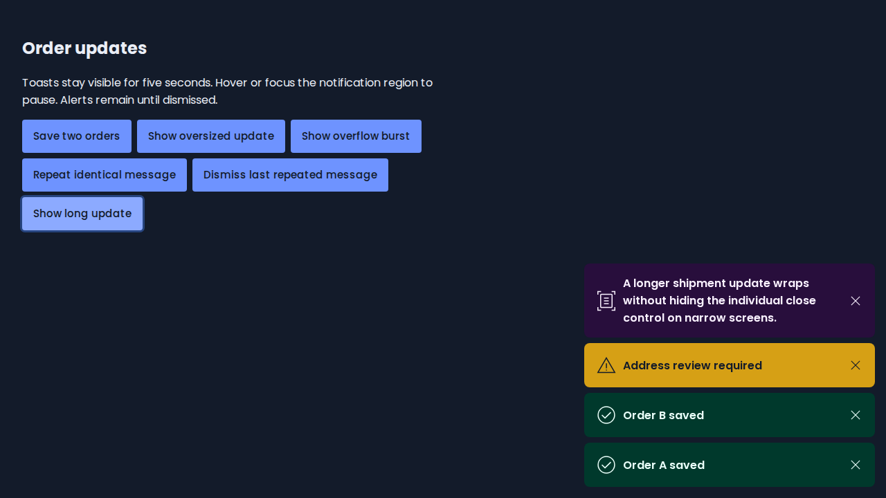
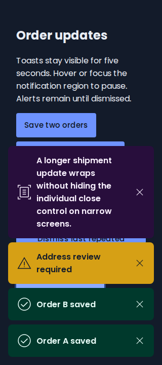
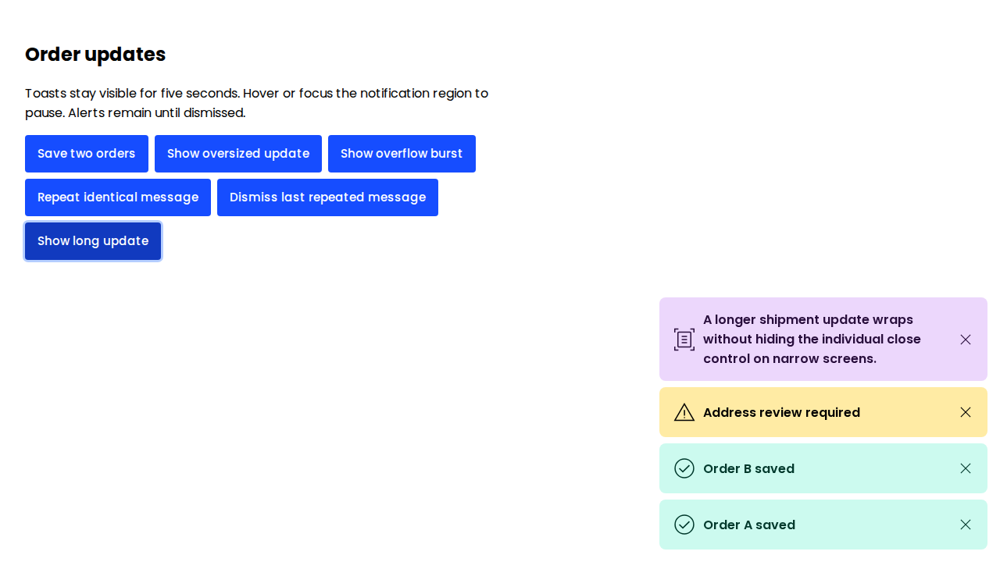
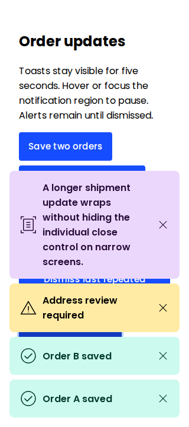

# Notification review evidence

Source: `4bb714d65ea5b4d3540913814ea1a634d8facce2` for [PR #69](https://github.com/lanej/easy-ui/pull/69).

Captured by the successful [notification browser matrix](https://github.com/lanej/easy-ui/actions/runs/40008880353), artifact [12525587391](https://github.com/lanej/easy-ui/actions/runs/40008880353/artifacts/12525587391). The artifact archive SHA256 is recorded in `manifest.json`; all PNG bytes were verified before publication.

## Visual review

All 28 captures were independently inspected individually at original resolution: light/dark at 1280px and 320px, covering the ordinary stack, oversized message, overflow burst, default placement, 80px offsets, absolute custom container and explicit `auto` edges. No visual defect was found. Text wraps without visible icon shrink or close-control collisions; clipping at scroll boundaries is intentional. Oversized captures show the reachable top close control, but their status icon is outside the captured long-card portion.

Screenshots establish appearance, not accessible names or focus/timing/scroll contracts. The separate browser assertions cover responsive grow-to-fit/shrink-back focus, pause/resume, individual pointer/keyboard dismissal, unseen-item duration and leading/trailing close reachability. Contrast was visually reviewed, not numerically audited. This review is not final human approval.

## Dark theme

Light theme

